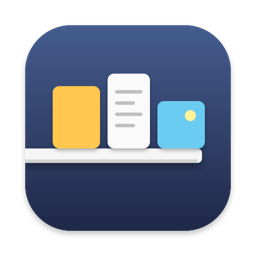

# Ledge

macOS용 드래그 선반(shelf) 앱. 끌고 있던 파일·텍스트·링크·이미지를 잠시 올려뒀다가, 다른 창·스페이스·전체화면 앱으로 가서 다시 끌어낸다. Yoink를 대체하려고 직접 만들었다.

*A drag-and-drop shelf for macOS. Park files, text, links and images while you switch windows or Spaces, then drag them back out. Built as a personal Yoink replacement. English UI included — see [English](#english) below.*



## 기능

- **드래그하면 나타난다.** 평소엔 숨어 있다가 무언가를 끌기 시작하면 선반이 등장하고, 놓으면 사라진다.
- **등장 위치**: 화면 가장자리(왼쪽/오른쪽/위/아래) 또는 **커서 옆**(끌다가 잠깐 멈추면 커서 옆에 뜸).
- **받는 것**: Finder 파일·폴더, 텍스트, URL, 이미지(브라우저에서 끌어온 웹 이미지도 파일로 받음), 파일 프로미스(메일·사진 앱).
- **선반에서**: 썸네일, QuickLook 미리보기(스페이스바), 여러 항목 스택으로 묶어 한 번에 꺼내기, 잠금(꺼내도 남김), 컨텍스트 메뉴(복사·이름 변경·공유·Finder에서 보기), 뺀 항목 되살리기.
- **클립보드 기록**(선택 모듈): 복사한 내용이 쌓이고, 비밀번호 관리자 등에서 복사한 건 쌓이지 않음.
- **전역 단축키**(접근성 권한 불필요): 선반 열고 닫기 `⌃⌥Y`, Finder 선택 항목 선반에 추가 `⌃⌥⇧Y`, 클립보드 내용 선반에 추가 `⌃⌥V`. 설정에서 변경 가능.
- **Finder 서비스 메뉴**, 선반 크기 조정, 무시할 앱 지정, 로그인 시 자동 실행, 한국어/영어.

## 설치

- macOS 14 Sonoma 이상.
- [Releases](../../releases)에서 `Ledge.zip`을 받아 풀고 `Ledge.app`을 응용 프로그램 폴더로 옮긴다.
- **첫 실행 시 "확인되지 않은 개발자" 경고가 뜬다.** 아직 Apple Developer ID로 서명하지 않았기 때문이다. 앱을 **우클릭 → 열기**로 한 번만 열면 이후엔 그냥 실행된다. 그래도 막히면 터미널에서:

```bash
xattr -dr com.apple.quarantine /Applications/Ledge.app
```

메뉴바 전용 앱이라 Dock에는 뜨지 않는다. 메뉴바의 선반 아이콘을 누르면 메뉴·설정이 나온다.

## 직접 빌드

```bash
brew install xcodegen
```

```bash
xcodegen generate
```

```bash
xcodebuild -scheme Ledge -configuration Release -derivedDataPath build
```

결과물은 `build/Build/Products/Release/Ledge.app`. 의존성은 [KeyboardShortcuts](https://github.com/sindresorhus/KeyboardShortcuts) 하나이며 Swift Package로 자동으로 받아진다.

## 설계 메모

- 샌드박스 없음(의도). 전역 마우스 모니터로 드래그를 감지하므로 접근성 권한을 요구하지 않는다.
- 선반에 올린 텍스트·웹 이미지 등 스니펫은 `~/Library/Application Support/Ledge/`에 파일로 저장되고, 선반에서 빼면 휴지통으로 간다.
- 자세한 기능 목록과 로드맵은 [ROADMAP.md](ROADMAP.md).

## English

Ledge is a menu-bar-only shelf app. It stays hidden until you start dragging something, then appears at a screen edge or next to the cursor; drop the item on it, move to another window or Space, and drag it back out. It accepts files, folders, text, URLs, images (including web images dragged from a browser) and file promises. Items get thumbnails and QuickLook, can be stacked, locked, renamed, shared and restored. An optional clipboard-history module is included. Global hotkeys (`⌃⌥Y` toggle, `⌃⌥⇧Y` add Finder selection, `⌃⌥V` add clipboard) work without Accessibility permission. UI is in Korean and English.

Requires macOS 14+. Download `Ledge.zip` from Releases, move `Ledge.app` to Applications. The app is not yet notarized, so right-click → Open on first launch (or run the `xattr` command above).

## License

MIT — see [LICENSE](LICENSE).
